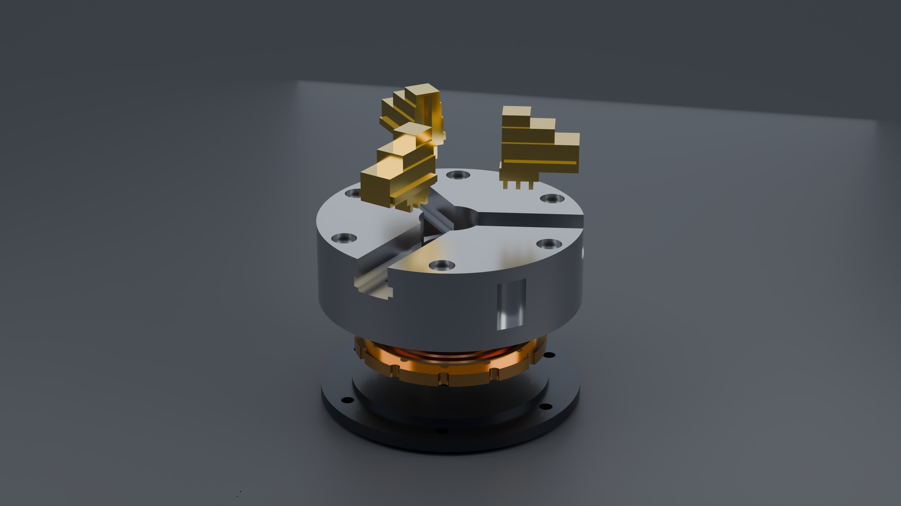
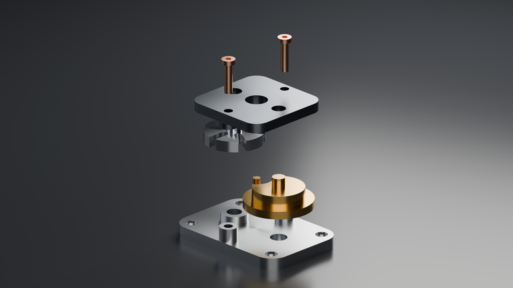
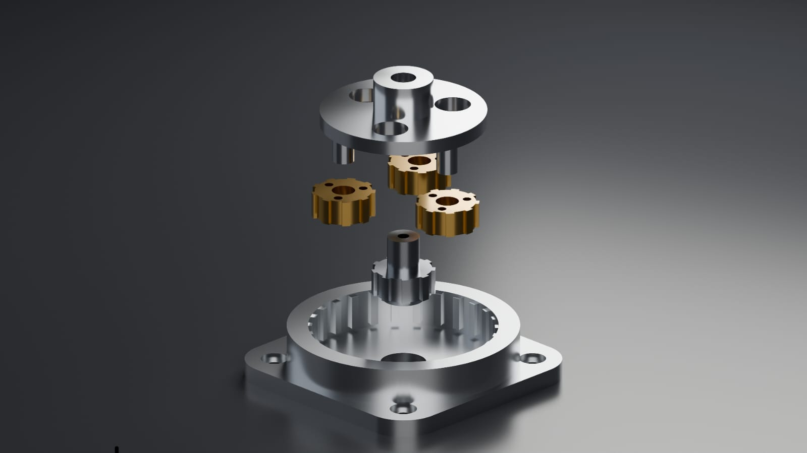

# CAD-models-project-
Mechanical 3D CAD portfolio featuring manufacturing-ready STEP (AP214) &amp; watertight STL assemblies, DFM/kinematic validation, and photorealistic PBR renders.
# Mechanical CAD & DFM Engineering Portfolio

# Parametric Mechanical CAD & DFM Portfolio

**Tolerance-checked 3D B-Rep mechanical assemblies exported as manufacturing-ready `.STEP` (AP214) and watertight binary `.STL` files, paired with exploded 4K Cycles PBR visualizations.**

---

## Featured Mechanical Assemblies

### 01. 3-Jaw Scroll-Actuated CNC Lathe Power Chuck

* **Directory:** [`./Project1`](./Project1)
* **CAD Files:** [`Assembled.step`](./Project1/Assembled.step) | [`Exploded.step`](./Project1/Exploded.step) | [`Assembled.stl`](./Project1/Assembled.stl) | [`Exploded.stl`](./Project1/Exploded.stl)
* **Measured Envelope & Volume:** `110.0 × 110.0 × 52.5 mm` (assembled bounding box) | `318.6 cm³` total solid volume (6 solids).
* **Design Highlights:**
  * **Actuation Architecture:** Flat scroll plate driving 3 radial stepped jaws indexed at 120° intervals for synchronized self-centering clamping.
  * **Manufacturing & DFM:** Slide guide clearances, scroll backface axial running clearance, peripheral lead-in chamfers, and central through-bore relief.
* **Geometry Audit:** Watertight binary STL (0 non-manifold edges, 0 boundary edges); 6 verified solids (15 pairs); **0.000000 mm³ static interference**.

---

### 02. 6-Slot Maltese Cross Geneva Indexing Drive

* **Directory:** [`./Project2`](./Project2)
* **CAD Files:** [`P02_Assembled.step`](./Project2/P02_Assembled.step) | [`P02_Exploded.step`](./Project2/P02_Exploded.step) | [`P02_Assembled.stl`](./Project2/P02_Assembled.stl) | [`P02_Exploded.stl`](./Project2/P02_Exploded.stl)
* **Measured Envelope & Kinematics:** 6-station intermittent rotary indexer (60° index per revolution) | Structural envelope: `150.0 × 106.0 × 50.0 mm` (baseplate footprint to top support bridge, 6 solids).
* **Design Highlights:**
  * **Geneva Geometry:** Center distance `a = 60.0 mm`, driven Maltese cross outer radius `R = 51.96 mm` (`a × cos 30°`), radial slot width `6.08 mm` (`0.04 mm` bilateral pin clearance).
  * **Dwell Locking Interface:** `R 8.95 mm` rotor locking hub engaging `R 9.00 mm` crescent dwell arcs (`0.05 mm` radial clearance) with crank clocked in the disengaged dwell phase.
  * **Structural Frame:** Rounded aluminum baseplate (`150.0 × 106.0 × 12.0 mm`) paired with a `10.0 mm` thick top alignment bridge spanning `Z = 40.0–50.0 mm`.
* **Geometry Audit:** Watertight binary STL & AP214 STEP (6 solids); crank clocked clear of the Maltese cross in the assembled dwell state for collision-free fit-up.

---

### 03. 3:1 Planetary Epicyclic Gear Reducer

* **Directory:** [`./Project3`](./Project3)
* **CAD Files:** [`P03_Assembled.step`](./Project3/P03_Assembled.step) | [`P03_Exploded.step`](./Project3/P03_Exploded.step) | [`P03_Assembled.stl`](./Project3/P03_Assembled.stl) | [`P03_Exploded.stl`](./Project3/P03_Exploded.stl)
* **Measured Envelope & Volume:** `Ø136.0 × 58.0 mm` (assembled bounding box) | `353.3 cm³` total solid volume (6 solids).
* **Design Highlights:**
  * **Gear Train Ratios:** 3:1 speed reduction with `Z_sun = 9` (`R_p = 17.0 mm`), `3× Z_planet = 9` (`R_p = 17.0 mm`, `34.2 mm` orbit radius), and internal ring `Z_ring = 27` (`R_p = 51.0 mm`).
  * **Carrier Assembly:** Rigid 3-pin planet carrier spaced at 120° phase intervals with integrated output shaft and axial Z-tier exploded spacing for DFM inspection.
* **Geometry Audit:** Watertight binary STL (0 non-manifold edges, 0 boundary edges); verified pitch-circle tooth counts (`9 / 9 / 27`); **0.000000 mm³ static interference** across all 15 solid pairs.

